# Modelo de Objetos y Diagrama de Clases — HuellaVet (Entrega 5 Final)

Modelo de objetos actualizado a la implementación final de los cinco módulos (**Backend**, **Pacientes**, **Inventario**, **Adopciones** y **Reportes**), al 27/11/2026 (migraciones `001` a `031`). En cada módulo las responsabilidades se dividen en:
- **Clases de dominio y reglas de negocio** (sin SQL, probadas de forma aislada con PHPUnit): `Cliente`, `Veterinario`, `Rescatista`, `VerificacionWhatsApp`, `CatalogoConfiguracion`, `Insumo`, `Compra`, `Promocion`, `Reintegros`, `CalendarioSanitario`, `IntervalosVacunas`, `MotivosTurno`, `FacturaConsulta`, `HorarioAtencion`, `PrecioTurno`, `MotorRecomendaciones`, `LotesPorVencer`, `ParametrosMotor` y los validadores (`Validador*`).
- **Controladores (`*Controlador`)**: verifican autenticación (`Auth::requerirRol`), CSRF (`Auth::verificarCsrf`) o tokens (`X-Servicio-Token` / `X-Tarea-Token`), delegan en el dominio/repositorio y responden JSON.
- **Repositorios (`*Repositorio`)** y **`Lotes`**: encapsulan todas las consultas PDO parametrizadas y las transacciones sobre las tablas propias del módulo.

El diagrama está en dos formatos con la misma información:
- **Mermaid** (abajo): GitHub lo dibuja al abrir este archivo.
- **PlantUML**: [`modelo-de-objetos.puml`](modelo-de-objetos.puml), agrupado por módulo y con las enumeraciones. Se ve en [plantuml.com](https://www.plantuml.com/plantuml) (pegar el texto), en VS Code (extensión PlantUML) o en draw.io (Arrange → Insert → Advanced → PlantUML), y desde ahí se exporta a PNG o PDF.

El modelo de datos (tablas) está en [`../base-de-datos/DER.md`](../base-de-datos/DER.md) y [`../base-de-datos/modelo-produccion.dbml`](../base-de-datos/modelo-produccion.dbml).

`«service»`: clase con reglas de negocio y sin estado propio. Un método marcado con `$` es estático (no usa la base).

---

## 1. Diagrama de Clases de Dominio (Mermaid)

```mermaid
classDiagram
    %% ---------- Backend ----------
    class Cliente {
        -int id
        -string nombre
        -string email
        -string passwordHash
        -string telefono
        +iniciarSesion(email, password) bool
        +registrarMascota(datos) Mascota
        +verHistorial(mascota) Consulta[]
        +verCalendario(mascota) EventoSanitario[]
        +verTurnos() Turno[]
        +postularse(adopcion, formulario) Postulacion
        +cancelarPostulacion(postulacion) void
        +agregarAlCarrito(producto, cantidad) void
        +publicarResena(estrellas, texto) Resena
    }

    class Veterinario {
        -int id
        -string nombre
        -string email
        -string passwordHash
        +iniciarSesion(email, password) bool
        +registrarTurno(mascota, fecha, hora, motivos) Turno
        +reprogramarTurno(turno, fecha, hora) void
        +atender(turno) Consulta
        +cargarCalendario(mascota, plan, fecha) EventoSanitario
        +validarRescatista(rescatista, aprobado, motivo) void
        +moderar(publicacion, aprobada, motivo) void
        +completarAdopcion(adopcion) void
        +cargarStock(item, cantidad, lote) void
        +retirarStock(item, cantidad, lote) void
        +constatarEntrega(compra) void
        +publicitarProducto(lote, porcentaje, hasta) Promocion
        +publicitarFranja(diaSemana, franja, porcentaje, hasta) PromocionFranja
        +responderResena(resena, respuesta) void
        +configurar(parametros) void
    }

    class Rescatista {
        -int id
        -string nombre
        -string email
        -string passwordHash
        -string telefono
        -string organizacion
        -EstadoValidacion estadoValidacion
        -string motivoRechazo
        +iniciarSesion(email, password) bool
        +aprobar() void
        +rechazar(motivo) void
        +puedePublicar() bool
        +publicar(mascota, titulo, descripcion, foto) Publicacion
        +elegirAdoptante(postulacion) void
    }

    class VerificacionWhatsApp {
        -int id
        -PropositoVerificacion proposito
        -string telefono
        -string codigoHash
        -int intentos
        -DateTime venceEn
        -DateTime usadoEn
        +generarCodigo() string
        +verificar(codigo) bool
        +estaVencido() bool
    }

    class CatalogoConfiguracion {
        +definiciones()$ array
        +validar(valores, actuales)$ array
        +armarParametros(filasGuardadas)$ array
    }

    class Resena {
        -int id
        -int estrellas
        -string texto
        -DateTime creadaEn
        -string respuesta
        -DateTime respondidaEn
        +publicar() void
        +responder(texto, veterinarioId) void
    }

    class Notificacion {
        -int id
        -TipoNotificacion tipo
        -Canal canal
        -string mensaje
        -DateTime fechaProgramada
        -DateTime enviadaEn
        -int intentos
        -string ultimoError
        -bool leida
        -string idOperacion
        +enviar() bool
        +marcarLeida() void
    }

    %% ---------- Pacientes ----------
    class Mascota {
        -int id
        -string nombre
        -EspecieMascota especie
        -string raza
        -Date fechaNacimiento
        -float pesoKg
        -string foto
        -bool activo
        +edad() int
        +historialClinico() Consulta[]
        +vacunasAlDia() bool
        +transferirA(nuevoDuenioId) void
    }

    class PlanSanitario {
        -int id
        -EspecieMascota especie
        -TipoEventoSanitario tipo
        -string nombre
        -Aplicacion aplicacion
        -int orden
        -int edadInicioSemanas
        -int repetirCadaMeses
    }

    class EventoSanitario {
        -int id
        -TipoEventoSanitario tipo
        -string nombre
        -Date fechaProgramada
        -Date fechaAplicada
        +estado(hoy) EstadoEvento
        +marcarAplicado(fecha, consultaId) void
    }

    class CalendarioSanitario {
        <<service>>
        +agregar(mascota, plan, fecha) EventoSanitario
        +marcarDada(evento, fecha) void
        +cambiarFecha(evento, fecha) void
        +quitar(evento) void
        +eventoParaTurno(mascota, plan, motivo) EventoSanitario
        +controlarIntervalo(mascota, plan, fecha) string
        +estadoDe(programada, aplicada, hoy)$ EstadoEvento
        +vacunasAlDia(eventos)$ bool
    }

    class IntervalosVacunas {
        <<service>>
        +dias(aplicacion, refuerzo)$ int
        +conflicto(fecha, aplicadas, dias)$ string
        +fechaMinima(aplicadas, dias)$ Date
    }

    class Turno {
        -int id
        -Date fecha
        -Time hora
        -MotivoTurno motivo
        -EstadoTurno estado
        -decimal precioConsulta
        -int descuento
        +iniciarAtencion() Consulta
        +reprogramar(fecha, hora) void
        +marcarAtendido() void
        +cancelar() void
        +marcarAusente() void
    }

    class MotivoDeTurno {
        -int id
        -MotivoTurno motivo
    }

    class MotivosTurno {
        <<service>>
        +principal(motivos)$ MotivoTurno
        +eventos(motivos)$ EventoSanitario[]
    }

    class AvisosTurno {
        <<service>>
        +asignado(turno)$ array
        +reprogramado(turno, momento)$ array
        +cancelado(turno)$ array
        +esChequeo(turno)$ bool
        +chequeoReprogramado(turno, adopcion, momento)$ array
        +chequeoCancelado(turno, adopcion)$ array
        +enviar(avisos)$ int
    }

    class HorarioAtencion {
        <<service>>
        +actual()$ array
    }

    class PrecioTurno {
        <<service>>
        +precioBase()$ decimal
        +franjaDe(fecha, hora)$ array
        +paraTurno(precioBase, promocion)$ array
        +conDescuento(precio, descuento)$ decimal
    }

    class PromocionFranja {
        -int id
        -int diaSemana
        -FranjaTurno franja
        -int porcentaje
        -Date hasta
        -DateTime terminadaEn
        +precioConDescuento(precioBase) decimal
        +terminar() void
    }

    class Consulta {
        -int id
        -string diagnostico
        -string observaciones
        -decimal valorBase
        -EstadoConsulta estado
        -DateTime finalizadaEn
        +registrarInsumo(insumo, cantidad) void
        +agregarProducto(producto, cantidad) void
        +calcularTotal() decimal
        +finalizar() FacturaConsulta
    }

    class ItemInsumoConsulta {
        -int cantidad
        -decimal costoUnitario
        +subtotal() decimal
    }

    class ItemProductoConsulta {
        -int cantidad
        -decimal precioUnitario
        +subtotal() decimal
    }

    class FacturaConsulta {
        -string numero
        -DateTime fecha
        -decimal subtotalBase
        -decimal subtotalInsumos
        -decimal subtotalProductos
        -decimal total
        -EstadoFacturaConsulta estado
        -MedioPago medioPago
        -DateTime pagadaEn
        +calcular(valorBase, insumos, productos)$ array
        +numero(id)$ string
        +marcarPagada(medioPago, veterinario, ahora) string
    }

    %% ---------- Adopciones ----------
    class Publicacion {
        -int id
        -string titulo
        -string descripcion
        -string foto
        -EstadoModeracion estadoModeracion
        -string motivoRechazo
        -bool activa
        +aprobar() Adopcion
        +rechazar(motivo) void
        +editar(datos) void
        +darDeBaja() void
    }

    class PublicacionRechazo {
        -int id
        -string motivo
        -DateTime rechazadaEn
    }

    class Adopcion {
        -int id
        -EstadoAdopcion estado
        -DateTime fechaInicio
        -DateTime fechaFin
        +recibirPostulacion(postulacion) void
        +elegirAdoptante(postulacion) void
        +asignarTurnoChequeo(turno) void
        +completar() void
        +cancelar() void
    }

    class Postulacion {
        -int id
        -DateTime fecha
        -string tipoVivienda
        -string otrasMascotas
        -string tiempoDisponible
        -EstadoPostulacion estado
        +elegir() void
        +rechazar() void
        +cancelar() void
    }

    class AvisosAdopcion {
        <<service>>
        +publicacionModerada(publicacion, motivoRechazo)$ array
        +postulacionNueva(postulacion)$ array
        +postulacionCancelada(postulacion)$ array
        +postulacionElegida(postulacion)$ array
        +adopcionFinalizada(adopcion, rescatista)$ array
    }

    %% ---------- Inventario ----------
    class Producto {
        -int id
        -string nombre
        -string descripcion
        -decimal precio
        -int stock
        -Categoria categoria
        -EspecieDestino especieDestino
        -EtapaVida etapaVida
        -Date fechaVencimiento
        -bool vence
        -bool activo
        +stockVendible() int
        +aLaVenta() bool
        +stockBajo(limite) bool
    }

    class LoteProducto {
        -int id
        -int numero
        -string codigo
        -Date vencimiento
        -int stock
        +nombre() string
        +vencido(hoy) bool
    }

    class Insumo {
        -int id
        -string nombre
        -Aplicacion aplicacion
        -int stock
        -Date fechaVencimiento
        -bool vence
        -decimal costo
        -EstadoInsumo estado
        -bool activo
        +estado() EstadoInsumo
        +sinVencer() int
        +stockBajo() bool
        +marcarPedido() bool
    }

    class LoteInsumo {
        -int id
        -int numero
        -string codigo
        -Date vencimiento
        -int stock
        +nombre() string
        +vencido(hoy) bool
    }

    class Lotes {
        <<service>>
        +paraCargar(item, vence, lote, nuevo) Lote
        +sacar(item, cantidad, primero, conVencidos) array
        +retirar(item, cantidad, lote) array
        +editar(item, lote, datos) bool
        +sincronizar(item) void
        +validarNuevo(datos, hoy, vence)$ array
        +nombre(numero, codigo)$ string
    }

    class BajaPorVencimiento {
        <<service>>
        +ejecutar(ahora) array
        +darDeBajaVencidos() array
        +darDeBaja(de, loteId) int
        +bajasRecientes() array
        -mandarAvisos(ahora) int
        +mensaje(baja)$ string
        +idOperacion(de, loteId)$ string
    }

    class MovimientoInventario {
        -int id
        -DateTime fecha
        -TipoMovimiento tipo
        -int cantidad
        -MotivoMovimiento motivo
        -string idOperacion
    }

    class Promocion {
        -int id
        -int porcentaje
        -Date hasta
        -DateTime terminadaEn
        +cantidadConDescuento(cantidad, quedan)$ int
        +subtotal(cantidad, precio, conDescuento, precioPromocion)$ decimal
        +validar(datos, hoy, vencimientoLote)$ array
        +terminar() void
    }

    class Carrito {
        -int id
        -EstadoCarrito estado
        +agregar(producto, cantidad) void
        +cambiarCantidad(producto, cantidad) void
        +quitar(producto) void
        +calcularTotal() decimal
        +confirmar() Compra
    }

    class ItemCarrito {
        -int cantidad
        -decimal precioUnitario
        -int cantidadPromocion
        -decimal precioPromocion
        +subtotal() decimal
    }

    class Compra {
        -string numero
        -DateTime fecha
        -DateTime pagarAntesDe
        -Date retirarHasta
        -decimal total
        -EstadoFacturaCompra estado
        -MotivoCancelacion motivoCancelacion
        -int reintegroPorcentaje
        -decimal reintegroMonto
        -EstadoReintegro reintegroEstado
        +pagarAntesDe(fecha)$ DateTime
        +retirarHasta(fecha)$ Date
        +politicaDeReintegro()$ array
        +numero(id)$ string
    }

    class Pago {
        -int id
        -decimal monto
        -string idExterno
        -EstadoPago estado
        +confirmar() void
        +rechazar() void
        +devolver() void
    }

    %% ---------- Reportes ----------
    class MotorRecomendaciones {
        <<service>>
        +ejecutarDiario()$ array
        +recordarCalendarioSanitario(hoy, ahora, semanaIso, conteo)$ void
        +revisarControlesAdopcion(hoy, ahora, conteo)$ void
        +revisarStockBajo(hoy, ahora, conteo)$ void
        +revisarVencimientos(ahora, semanaIso, conteo)$ void
        +revisarFranjasConPocosTurnos()$ array
    }

    class LotesPorVencer {
        <<service>>
        +descuento(diasRestantes)$ int
        +sugerencia(lote)$ array
        +vencido(lote)$ array
        +nombre(numero, codigo)$ string
    }

    class ParametrosMotor {
        <<service>>
        +diasLiquidar()$ int
        +limiteStockBajo()$ int
    }

    Cliente "1" --> "*" Mascota : es dueño de
    Rescatista "1" --> "*" Mascota : tiene a cargo
    Cliente "1" --> "*" Postulacion : se postula
    Cliente "1" --> "*" Carrito : arma
    Cliente "1" --> "*" Resena : escribe
    Rescatista "1" --> "*" Publicacion : publica
    Publicacion "1" --> "*" PublicacionRechazo : historial de rechazos
    Publicacion "1" --> "0..1" Adopcion : abre
    Adopcion "1" --> "*" Postulacion : recibe
    Adopcion "0..1" --> "0..1" Turno : chequeo obligatorio
    Mascota "1" --> "*" Turno : agenda
    Mascota "1" --> "*" EventoSanitario : calendario
    PlanSanitario "1" --> "*" EventoSanitario : programa
    Turno "1" --> "1..*" MotivoDeTurno : motivos
    MotivoDeTurno "*" --> "0..1" EventoSanitario : da la dosis
    PromocionFranja "0..1" --> "*" Turno : aplica descuento
    Turno "1" --> "0..1" Consulta : inicia
    Consulta "1" --> "*" ItemInsumoConsulta : usa
    Consulta "1" --> "*" ItemProductoConsulta : vende
    Consulta "1" --> "1" FacturaConsulta : genera
    ItemInsumoConsulta "*" --> "1" Insumo : refiere a
    ItemProductoConsulta "*" --> "1" Producto : refiere a
    Producto "1" --> "*" LoteProducto : su stock está en
    Insumo "1" --> "*" LoteInsumo : su stock está en
    Producto "1" --> "*" Promocion : tiene
    LoteProducto "1" --> "*" Promocion : descuento de sus unidades
    LoteProducto "1" --> "*" MovimientoInventario : registra
    LoteInsumo "1" --> "*" MovimientoInventario : registra
    Carrito "1" --> "*" ItemCarrito : contiene
    ItemCarrito "*" --> "1" Producto : refiere a
    Carrito "1" --> "0..1" Compra : genera (factura_compra)
    Compra "1" --> "*" Pago : cobra
    Lotes ..> LoteProducto : saca primero el que vence antes
    Lotes ..> LoteInsumo : saca primero el que vence antes
    Veterinario "1" --> "*" FacturaConsulta : marca pagada
    BajaPorVencimiento ..> Lotes : deja en 0 el lote vencido
    BajaPorVencimiento ..> MovimientoInventario : «create» VENCIMIENTO
    BajaPorVencimiento ..> Notificacion : «create»
    CalendarioSanitario ..> EventoSanitario : carga y marca
    CalendarioSanitario ..> IntervalosVacunas : días entre dosis
    MotivosTurno ..> MotivoDeTurno : lee
    AvisosTurno ..> Notificacion : «create»
    AvisosAdopcion ..> Notificacion : «create»
    MotorRecomendaciones ..> Notificacion : «create»
    MotorRecomendaciones ..> LotesPorVencer : qué liquidar
    MotorRecomendaciones ..> ParametrosMotor : umbrales
    Veterinario ..> CatalogoConfiguracion : configura
```

---

## 2. Para qué sirve cada clase y dónde está implementada

### Usuarios, Configuración, Reseñas y Notificaciones (`PAW--Backend--TPIntegrador`)
| Clase | Archivo | Responsabilidad |
|---|---|---|
| `Cliente`, `Veterinario`, `Rescatista` | `src/Cliente.php`, `src/Veterinario.php`, `src/Rescatista.php` | Modelos de los tres roles de usuario del sistema. En `Rescatista`, `puedePublicar()` devuelve `true` solo si `estadoValidacion === 'APROBADO'`; un rechazo guarda el motivo (migración 022). |
| `VerificacionWhatsApp` | `src/VerificacionWhatsApp.php`, `src/VerificacionControlador.php`, `src/VerificacionRepositorio.php` | Genera códigos de 6 dígitos hasheados (`password_hash`), controla límites de envío (1 por minuto, 5 por hora) y valida el teléfono por WhatsApp antes de crear la cuenta o cambiar el número en "Mis datos". |
| `Jwt` y `Sesion` | `src/Jwt.php`, `src/Sesion.php` | Emisión del JWT firmado con clave privada RSA (`RS256`), generación del token CSRF y configuración de la cookie `huellavet_sesion`. |
| `CatalogoConfiguracion` | `src/CatalogoConfiguracion.php`, `src/ConfiguracionControlador.php`, `src/ConfiguracionRepositorio.php` | Define los parámetros configurables por la veterinaria (horarios, precio de consulta, umbrales del motor, plazos/reintegros de la tienda, datos de contacto y, desde el 26/11, los días mínimos entre dosis de cada vacuna), sus tipos, rangos, valores por defecto y validaciones cruzadas. |
| `ResenaControlador` y `ValidadorResena` | `src/ResenaControlador.php`, `src/ResenaRepositorio.php`, `src/ValidadorResena.php` | Publicación de reseñas de 1 a 5 estrellas, borrado de las propias, respuesta de la veterinaria y aviso en la campana de la veterinaria al recibir una nueva reseña. |
| `NotificacionControlador` y `WhatsAppCliente` | `src/NotificacionControlador.php`, `src/NotificacionRepositorio.php`, `src/WhatsAppCliente.php` | Recepción interna de avisos (`POST /internal/notificaciones`) con idempotencia por `id_operacion`, listado en la campana e historial paginado, marcado como leída y despacho de WhatsApp (en el momento y reintentos, hasta 5). Tipos de aviso, entre ellos `TURNO` (migración 024). |

### Clínica (`PAW--Pacientes--TPIntegrador`)
| Clase | Archivo | Responsabilidad |
|---|---|---|
| `MascotaControlador` y `MascotaInternoControlador` | `src/MascotaControlador.php`, `src/MascotaInternoControlador.php`, `src/MascotaRepositorio.php` | Ficha clínica con foto, alta, edición, baja lógica (bloqueada si tiene turnos programados) y transferencia interna al adoptante (`POST /internal/mascotas/{id}/transferir`). |
| `CalendarioSanitario` y `PlanSanitario` | `src/CalendarioSanitario.php`, `src/CalendarioControlador.php`, `src/ValidadorCalendario.php` | El calendario lo carga la veterinaria, dosis por dosis del plan de la especie (`plan_sanitario`), respetando el orden: agregar, marcar como dada, cambiar la fecha y quitar. Calcula el estado de cada evento (`APLICADO`, `VENCIDO`, `PROXIMO`, `PENDIENTE`), si la mascota tiene las vacunas al día y sugiere la próxima dosis. Un turno de vacunación o desparasitación es para un evento del calendario (`eventoParaTurno`). |
| `IntervalosVacunas` | `src/IntervalosVacunas.php` | Días mínimos entre dos dosis de la misma vacuna o desparasitación (y entre refuerzos), configurables por la veterinaria: detecta el conflicto y calcula la primera fecha posible (26/11). |
| `TurnoControlador`, `MotivosTurno` y `HorarioAtencion` | `src/TurnoControlador.php`, `src/TurnoRepositorio.php`, `src/MotivosTurno.php`, `src/HorarioAtencion.php` | Agenda diaria, alta, reprogramación, cancelación y marcado de ausente, respetando el horario configurado (también el cortado). Un turno puede tener varios motivos (`turno_motivo`, migración 026), cada vacuna o desparasitación con su evento del calendario; `turno.motivo` es el principal. |
| `AvisosTurno` | `src/AvisosTurno.php` | Avisa al dueño, por la campana y por WhatsApp, cuando le dan, le reprograman o le cancelan un turno (tipo `TURNO`). El turno del chequeo de adopción no avisa al cargarse (lo avisa Adopciones al asignarlo); si se reprograma o se cancela, avisa al adoptante y a la rescatista (27/11). |
| `PrecioTurno` y `PromocionFranjaControlador` | `src/PrecioTurno.php`, `src/PromocionFranjaControlador.php`, `src/PromocionFranjaRepositorio.php` | Promociones sobre franjas de turnos (lunes a sábado, mañana o tarde) desde "Qué promocionar", y el precio de la consulta congelado en el turno al sacarlo. |
| `ConsultaControlador` y `FacturaConsulta` | `src/ConsultaControlador.php`, `src/ConsultaRepositorio.php`, `src/FacturaConsulta.php`, `src/ClienteInventario.php` | Atención del turno, diagnóstico, insumos (la dosis de cada vacuna del turno) y productos, descuento transaccional de stock en Inventario (`POST /internal/stock/descontar`, del lote que vence primero) y factura `C-…`. Al finalizar, marca como dadas las dosis del calendario. La veterinaria marca la factura como pagada con el medio de pago: efectivo, transferencia o tarjeta (migración 030, 27/11). |

### Adopciones (`PAW--Adopciones--TPIntegrador`)
| Clase | Archivo | Responsabilidad |
|---|---|---|
| `PublicacionControlador` y `PublicacionRechazo` | `src/PublicacionControlador.php` | Alta, edición y baja de publicaciones con foto por rescatistas aprobados, y moderación por la veterinaria. Cada rechazo queda en el historial (`publicacion_rechazo`, migración 023) aunque la publicación se corrija y se apruebe después. |
| `AdopcionControlador` y `AdopcionRepositorio` | `src/AdopcionControlador.php`, `src/AdopcionRepositorio.php`, `src/ClientePacientes.php` | Postulaciones de clientes (que pueden cancelar la suya, migración 021), elección del adoptante, turno de chequeo obligatorio, cierre con transferencia de la mascota y listado paginado con detalle. |
| `AvisosAdopcion` | `src/AvisosAdopcion.php`, `src/ClienteBackend.php` | Envía a Backend (`POST /internal/notificaciones`) los avisos del circuito de adopción (campana y WhatsApp) con `id_operacion` fijo. Desde el 27/11, al elegido le llega también por WhatsApp y, al completarse la adopción, a la rescatista (campana y WhatsApp). |

### Tienda e Inventario (`PAW--Inventario--TPIntegrador`)
| Clase | Archivo | Responsabilidad |
|---|---|---|
| `ProductoControlador` y `Promocion` | `src/ProductoControlador.php`, `src/ProductoRepositorio.php`, `src/ValidadorProducto.php`, `src/Promocion.php`, `src/PromocionControlador.php`, `src/PromocionRepositorio.php` | Catálogo público con búsqueda y filtros, ABM de productos con imagen y "Vence" (migración 029), y promociones ("Publicitar" desde "Qué liquidar"): una promoción es de un lote y el descuento vale para las unidades que le quedan; si el cliente lleva más, las demás van a precio normal (dos líneas en la compra). |
| `Lotes`, `LoteProducto` y `LoteInsumo` | `src/Lotes.php` | El stock de productos e insumos está en lotes (migraciones 028 y 029), numerados L1, L2, L3… con el número del fabricante opcional y su vencimiento. Si el producto o insumo vence, cada lote lleva su fecha; si no, ninguno. Carga en un lote que ya existe o en uno nuevo, retira de un lote o de los que vencen primero, y vende y usa en las consultas primero el lote sin vencer que vence antes (lo vencido no se vende ni se usa). Mantiene `stock` y `fecha_vencimiento` del producto o insumo. |
| `BajaPorVencimiento` | `src/BajaPorVencimiento.php`, `src/TareaControlador.php` | Tarea diaria del motor (`POST /api/inventario/tareas/vencer-lotes`, con `X-Tarea-Token`): da de baja los lotes vencidos con stock de productos e insumos, con un movimiento `SALIDA`/`VENCIMIENTO` por lote (migración 031, `id_operacion` `vencimiento-{producto\|insumo}-{lote}`) y un aviso a las veterinarias (27/11). |
| `Insumo` | `src/Insumo.php`, `src/InsumoControlador.php`, `src/InsumoRepositorio.php`, `src/InsumoValidador.php` | Reglas del insumo: estado `DISPONIBLE` / `EN_FALTA` según el stock, "Ya pedido", stock bajo (sin lo vencido), qué vacuna o antiparasitario del calendario es (`aplicacion`, migración 025) y si vence. |
| `StockInternoControlador` | `src/StockInternoControlador.php`, `src/StockInternoRepositorio.php` | Endpoint interno `POST /internal/stock/descontar` con bloqueo de filas (`FOR UPDATE`), transacción todo-o-nada, idempotencia por `id_operacion` y un movimiento por lote. |
| `Compra`, `Vencimientos` y `Reintegros` | `src/Compra.php`, `src/CarritoControlador.php`, `src/CompraControlador.php`, `src/Vencimientos.php`, `src/Reintegros.php`, `src/MercadoPago.php`, `src/PagoControlador.php` | Carrito, confirmación con reserva de stock por lote y factura `V-…`, plazos configurables de pago y retiro en días hábiles, pago con Mercado Pago (y webhook firmado), cancelación (el stock vuelve al lote del que salió) con devolución parcial y recordatorios de retiro. |

### Motor y Reportes (`PAW--Reportes--TPIntegrador`)
| Clase | Archivo | Responsabilidad |
|---|---|---|
| `MotorRecomendaciones` y `ParametrosMotor` | `src/MotorRecomendaciones.php`, `src/ParametrosMotor.php`, `src/ClienteNotificaciones.php` | Ejecución diaria (`ejecutarDiario()`) de las reglas con los parámetros configurados: `recordarCalendarioSanitario()`, `revisarControlesAdopcion()`, `revisarStockBajo()` (sin lo vencido), `revisarVencimientos()` (por lote, y los lotes vencidos de productos e insumos) y `revisarFranjasConPocosTurnos()`. |
| `LotesPorVencer` | `src/LotesPorVencer.php` | "Qué liquidar" por lote: el descuento sugerido, el texto que nombra el lote ("lote L1 (FL-2612): vence el…") y el aviso de cada lote vencido con stock. La usan el reporte y el motor, así dicen lo mismo. |
| `ReporteControlador` y `ReporteRepositorio` | `src/ReporteControlador.php`, `src/ReporteRepositorio.php`, `src/ValidadorReportes.php` | Endpoints de sugerencias (`GET /api/reportes/sugerencias`), turnos atendidos (`GET /api/reportes/turnos-atendidos`) y stock con movimientos (`GET /api/reportes/stock`). |

---

## 3. Enumeraciones del modelo

Los valores son los de la base de producción (columnas `ENUM`, ver `modelo-produccion.dbml`), salvo `EstadoEvento`, que se calcula.

- **`Rol`**: `CLIENTE`, `VETERINARIO`, `RESCATISTA`
- **`EstadoValidacion`**: `PENDIENTE`, `APROBADO`, `RECHAZADO`
- **`PropositoVerificacion`**: `REGISTRO`, `CAMBIO`
- **`TipoNotificacion`**: `VACUNA`, `CONTROL_ADOPCION`, `STOCK_BAJO`, `PROMOCION`, `CUENTA`, `POSTULACION`, `COMPRA`, `RESENA`, `TURNO`
- **`Canal`**: `WEB`, `WHATSAPP`
- **`EspecieMascota`**: `PERRO`, `GATO`, `OTRO`
- **`TipoEventoSanitario`**: `VACUNA`, `DESPARASITACION`
- **`EstadoEvento`**: `APLICADO`, `VENCIDO`, `PROXIMO`, `PENDIENTE`
- **`Aplicacion`**: `SEXTUPLE`, `TRIPLE_FELINA`, `ANTIRRABICA`, `TOS_PERRERAS`, `LEUCEMIA_FELINA`, `ANTIPARASITARIO`
- **`MotivoTurno`**: `CONSULTA`, `VACUNACION`, `CHEQUEO_ADOPCION`, `DESPARASITACION`, `CASTRACION`, `CIRUGIA`, `CONTROL`, `URGENCIA`
- **`EstadoTurno`**: `PROGRAMADO`, `EN_ATENCION`, `ATENDIDO`, `CANCELADO`, `AUSENTE`
- **`FranjaTurno`**: `MANIANA`, `TARDE`
- **`EstadoConsulta`**: `ABIERTA`, `FINALIZADA`
- **`EstadoFacturaConsulta`**: `PENDIENTE_PAGO`, `PAGADA`
- **`MedioPago`** (030): `EFECTIVO`, `TRANSFERENCIA`, `TARJETA`
- **`EstadoModeracion`**: `PENDIENTE`, `APROBADA`, `RECHAZADA`
- **`EstadoAdopcion`**: `PUBLICADA`, `CON_POSTULANTES`, `ADOPTANTE_ELEGIDO`, `CHEQUEO_PENDIENTE`, `FINALIZADA`, `CANCELADA`
- **`EstadoPostulacion`**: `PENDIENTE`, `ELEGIDA`, `RECHAZADA`, `CANCELADA`
- **`Categoria`**: `MEDICAMENTO`, `ALIMENTO`, `ACCESORIO`
- **`EspecieDestino`**: `PERRO`, `GATO`, `TODAS`
- **`EtapaVida`**: `CACHORRO`, `ADULTO`, `SENIOR`, `TODAS`
- **`EstadoInsumo`**: `DISPONIBLE`, `EN_FALTA`, `YA_PEDIDO`
- **`TipoMovimiento`**: `ENTRADA`, `SALIDA`, `AJUSTE`
- **`MotivoMovimiento`**: `CARGA_VETERINARIO`, `CONSULTA`, `VENTA`, `AJUSTE`, `VENTA_CANCELADA`, `VENCIMIENTO` (031)
- **`EstadoCarrito`**: `ABIERTO`, `CONFIRMADO`, `PAGADO`, `RETIRADO`, `CANCELADO`
- **`EstadoFacturaCompra`**: `PENDIENTE_PAGO`, `PAGADA`, `ENTREGADA`, `CANCELADA`
- **`MotivoCancelacion`**: `COMPRADOR`, `SIN_PAGO`, `VENCIDA`
- **`EstadoReintegro`**: `PENDIENTE`, `HECHO`
- **`EstadoPago`**: `PENDIENTE`, `APROBADO`, `RECHAZADO`, `DEVUELTO`

---

## 4. Cambios desde la versión del 23/11

- **Correcciones finales** (27/11, migraciones 030 y 031): `FacturaConsulta` con `medioPago` y `pagadaEn` (`MedioPago`, la veterinaria la marca pagada); `BajaPorVencimiento` en Inventario y el motivo `VENCIMIENTO`; `AvisosTurno` con los avisos del chequeo de adopción; `AvisosAdopcion` avisa a la rescatista al completarse la adopción.
- **Lotes** (migraciones 028 y 029): `LoteProducto`, `LoteInsumo` y la clase `Lotes`; `Producto` e `Insumo` tienen `vence` y su stock es la suma de los lotes; `Promocion` es de un lote; `ItemCarrito` guarda cuántas unidades fueron con descuento; `LotesPorVencer` en Reportes.
- **Turnos con varios motivos** (026 y 027): `MotivoDeTurno` (tabla `turno_motivo`) y `MotivosTurno`; más motivos (`DESPARASITACION`, `CASTRACION`, `CIRUGIA`, `CONTROL`, `URGENCIA`).
- **Calendario cargado por la veterinaria** (025, 26/11): `PlanSanitario`, `IntervalosVacunas`; el insumo dice qué vacuna es (`aplicacion`).
- **Avisos de turnos** (024): `AvisosTurno` y el tipo de aviso `TURNO`.
- **Adopciones**: historial de rechazos (`PublicacionRechazo`, 023) y postulaciones canceladas (`CANCELADA`, 021); motivo del rechazo de un rescatista (022).
- El PDF `Diagrama_de_clases_HuellaVet_v3.pdf` es de antes de estos cambios: la versión vigente es este archivo y `modelo-de-objetos.puml`.
