# Modelo de Objetos y Diagrama de Clases — HuellaVet (Entrega 5 Final)

Modelo de objetos actualizado a la implementación final de los cinco módulos (**Backend**, **Pacientes**, **Inventario**, **Adopciones** y **Reportes**). En cada módulo las responsabilidades se dividen en:
- **Clases de dominio y reglas de negocio** (sin SQL, probadas de forma aislada con PHPUnit): `Cliente`, `Veterinario`, `Rescatista`, `VerificacionWhatsApp`, `CatalogoConfiguracion`, `Insumo`, `Compra`, `Promocion`, `Reintegros`, `CalendarioSanitario`, `FacturaConsulta`, `HorarioAtencion`, `PrecioTurno`, `MotorRecomendaciones`, `ParametrosMotor` y los validadores (`Validador*`).
- **Controladores (`*Controlador`)**: verifican autenticación (`Auth::requerirRol`), CSRF (`Auth::verificarCsrf`) o tokens (`X-Servicio-Token` / `X-Tarea-Token`), delegan en el dominio/repositorio y responden JSON.
- **Repositorios (`*Repositorio`)**: encapsulan todas las consultas PDO parametrizadas y las transacciones sobre las tablas propias del módulo.

---

## 1. Diagrama de Clases de Dominio (Mermaid)

```mermaid
classDiagram
    class Cliente {
        -int id
        -string nombre
        -string email
        -string passwordHash
        -string telefono
        +iniciarSesion(email, password) bool
        +registrarMascota(datos) Mascota
        +verHistorial(mascota) Consulta[]
        +verTurnos() Turno[]
        +postularse(adopcion, formulario) Postulacion
        +agregarAlCarrito(producto, cantidad) void
        +publicarResena(estrellas, texto) Resena
    }

    class Veterinario {
        -int id
        -string nombre
        -string email
        -string passwordHash
        +iniciarSesion(email, password) bool
        +registrarTurno(mascota, fecha, hora, motivo) Turno
        +reprogramarTurno(turno, fecha, hora) void
        +atender(turno) Consulta
        +validarRescatista(rescatista, aprobado) void
        +moderar(publicacion, aprobada, motivo) void
        +completarAdopcion(adopcion) void
        +cargarStock(item, cantidad) void
        +constatarEntrega(facturaCompra) void
        +publicitarProducto(producto, porcentaje, hasta) Promocion
        +publicitarFranja(diaSemana, franja, porcentaje, hasta) PromocionFranja
        +responderResena(resena, respuesta) void
    }

    class Rescatista {
        -int id
        -string nombre
        -string email
        -string passwordHash
        -string telefono
        -string organizacion
        -EstadoValidacion estadoValidacion
        +iniciarSesion(email, password) bool
        +aprobar() void
        +rechazar() void
        +puedePublicar() bool
        +publicar(mascota, titulo, descripcion, foto) Publicacion
        +elegirAdoptante(postulacion) void
    }

    class VerificacionWhatsApp {
        -int id
        -string proposito
        -string telefono
        -string codigoHash
        -int intentos
        -DateTime venceEn
        -DateTime usadoEn
        +generarCodigo() string
        +verificar(codigo) bool
        +estaVencido() bool
    }

    class CatalogoConfiguracion {
        +definiciones() array
        +validar(valores, actuales) array
        +armarParametros(filasGuardadas) array
    }

    class Resena {
        -int id
        -int autorId
        -int estrellas
        -string texto
        -DateTime creadaEn
        -string respuesta
        -DateTime respondidaEn
        +publicar() void
        +responder(texto, veterinarioId) void
    }

    class Notificacion {
        -int id
        -int usuarioId
        -TipoNotificacion tipo
        -Canal canal
        -string mensaje
        -DateTime fechaProgramada
        -DateTime enviadaEn
        -int intentos
        -string ultimoError
        -bool leida
        -string idOperacion
        +enviar() bool
        +marcarLeida() void
    }

    class Mascota {
        -int id
        -int duenioId
        -string nombre
        -Especie especie
        -string raza
        -Date fechaNacimiento
        -float pesoKg
        -string foto
        -bool activo
        +edad() int
        +historialClinico() Consulta[]
        +generarCalendarioSanitario() void
        +vacunasAlDia() bool
        +transferirA(nuevoDuenioId) void
    }

    class EventoSanitario {
        -int id
        -TipoEvento tipo
        -string nombre
        -Date fechaProgramada
        -Date fechaAplicada
        +marcarAplicado(fecha, consultaId) EventoSanitario
        +estaVencido() bool
    }

    class Turno {
        -int id
        -Date fecha
        -Time hora
        -MotivoTurno motivo
        -EstadoTurno estado
        -decimal precioConsulta
        -int descuento
        +iniciarAtencion() Consulta
        +reprogramar(fecha, hora) void
        +marcarAtendido() void
        +cancelar() void
        +marcarAusente() void
    }

    class PromocionFranja {
        -int id
        -int diaSemana
        -string franja
        -int porcentaje
        -Date hasta
        -DateTime terminadaEn
        +precioConDescuento(precioBase) decimal
        +terminar() void
    }

    class Consulta {
        -int id
        -string diagnostico
        -string observaciones
        -decimal valorBase
        -EstadoConsulta estado
        -DateTime finalizadaEn
        +registrarInsumo(insumo, cantidad) void
        +agregarProducto(producto, cantidad) void
        +calcularTotal() decimal
        +finalizar() FacturaConsulta
    }

    class ItemInsumoConsulta {
        -int cantidad
        -decimal costoUnitario
        +subtotal() decimal
    }

    class ItemProductoConsulta {
        -int cantidad
        -decimal precioUnitario
        +subtotal() decimal
    }

    class FacturaConsulta {
        -string numero
        -DateTime fecha
        -decimal subtotalBase
        -decimal subtotalInsumos
        -decimal subtotalProductos
        -decimal total
        -EstadoFacturaConsulta estado
        +calcular(valorBase, insumos, productos) array
        +numeroParaId(id) string
    }

    class Publicacion {
        -int id
        -string titulo
        -string descripcion
        -string foto
        -EstadoModeracion estadoModeracion
        -string motivoRechazo
        -bool activa
        +aprobar() Adopcion
        +rechazar(motivo) void
        +editar(datos) void
        +darDeBaja() void
    }

    class Adopcion {
        -int id
        -EstadoAdopcion estado
        -DateTime fechaInicio
        -DateTime fechaFin
        +recibirPostulacion(postulacion) void
        +elegirAdoptante(postulacion) void
        +asignarTurnoChequeo(turno) void
        +completar() void
        +cancelar() void
    }

    class Postulacion {
        -int id
        -DateTime fecha
        -string tipoVivienda
        -string otrasMascotas
        -string tiempoDisponible
        -EstadoPostulacion estado
        +aceptar() void
        +rechazar() void
    }

    class Producto {
        -int id
        -string nombre
        -string descripcion
        -decimal precio
        -int stock
        -Categoria categoria
        -Especie especieDestino
        -Date fechaVencimiento
        -bool activo
        +descontarStock(cantidad) void
        +reponer(cantidad) void
        +stockBajo(limite) bool
    }

    class Promocion {
        -int id
        -int productoId
        -int porcentaje
        -Date hasta
        -DateTime terminadaEn
        +precioConDescuento(precio) decimal
        +terminar() void
    }

    class Insumo {
        -int id
        -string nombre
        -int stock
        -decimal costo
        -EstadoInsumo estado
        +descontarStock(cantidad) void
        +reponer(cantidad) void
        +stockBajo() bool
    }

    class MovimientoInventario {
        -int id
        -DateTime fecha
        -TipoMovimiento tipo
        -int cantidad
        -MotivoMovimiento motivo
        -string idOperacion
    }

    class Carrito {
        -int id
        -EstadoCarrito estado
        +agregar(producto, cantidad) void
        +cambiarCantidad(producto, cantidad) void
        +quitar(producto) void
        +calcularTotal() decimal
        +confirmar() FacturaCompra
    }

    class ItemCarrito {
        -int cantidad
        -decimal precioUnitario
        +subtotal() decimal
    }

    class Compra {
        -string numero
        -DateTime fecha
        -DateTime pagarAntesDe
        -Date retirarHasta
        -decimal total
        -EstadoFacturaCompra estado
        -MotivoCancelacion motivoCancelacion
        -int reintegroPorcentaje
        -decimal reintegroMonto
        -EstadoReintegro reintegroEstado
        +calcularRetirarHasta(fecha, diasHabiles) DateTimeImmutable
        +porcentajeDeReintegro(ahora, retirarHasta, politica) int
        +recordatorioDeHoy(fechaCompra, retirarHasta, ahora) string
    }

    class Pago {
        -int id
        -decimal monto
        -string idExterno
        -EstadoPago estado
        +confirmar() void
        +rechazar() void
        +devolver() void
    }

    class MotorRecomendaciones {
        +ejecutarDiario() array
        +recordarCalendarioSanitario(hoy, ahora, semanaIso, conteo) void
        +revisarControlesAdopcion(hoy, ahora, conteo) void
        +revisarStockBajo(hoy, ahora, conteo) void
        +revisarVencimientos(ahora, semanaIso, conteo) void
        +revisarFranjasConPocosTurnos() array
    }

    Cliente "1" --> "*" Mascota : es dueño de
    Rescatista "1" --> "*" Mascota : tiene a cargo
    Cliente "1" --> "*" Postulacion : se postula
    Cliente "1" --> "*" Carrito : arma
    Cliente "1" --> "*" Resena : escribe
    Rescatista "1" --> "*" Publicacion : publica
    Publicacion "1" --> "0..1" Adopcion : abre
    Adopcion "1" --> "*" Postulacion : recibe
    Adopcion "0..1" --> "0..1" Turno : chequeo obligatorio
    Mascota "1" --> "*" Turno : agenda
    Mascota "1" --> "*" EventoSanitario : calendario
    PromocionFranja "0..1" --> "*" Turno : aplica descuento
    Turno "1" --> "0..1" Consulta : inicia
    Consulta "1" --> "*" ItemInsumoConsulta : usa
    Consulta "1" --> "*" ItemProductoConsulta : vende
    Consulta "1" --> "1" FacturaConsulta : genera
    ItemInsumoConsulta "*" --> "1" Insumo : refiere a
    ItemProductoConsulta "*" --> "1" Producto : refiere a
    Producto "1" --> "*" Promocion : tiene
    Producto "1" --> "*" MovimientoInventario : registra
    Insumo "1" --> "*" MovimientoInventario : registra
    Carrito "1" --> "*" ItemCarrito : contiene
    ItemCarrito "*" --> "1" Producto : refiere a
    Carrito "1" --> "0..1" Compra : genera (factura_compra)
    Compra "1" --> "*" Pago : cobra
    MotorRecomendaciones ..> Notificacion : «create»
    Veterinario ..> CatalogoConfiguracion : configura
```

---

## 2. Para qué sirve cada clase y dónde está implementada

### Usuarios, Configuración, Reseñas y Notificaciones (`PAW--Backend--TPIntegrador`)
| Clase | Archivo | Responsabilidad |
|---|---|---|
| `Cliente`, `Veterinario`, `Rescatista` | `src/Cliente.php`, `src/Veterinario.php`, `src/Rescatista.php` | Modelos de los tres roles de usuario del sistema. En `Rescatista`, `puedePublicar()` devuelve `true` solo si `estadoValidacion === 'APROBADO'`. |
| `VerificacionWhatsApp` | `src/VerificacionWhatsApp.php`, `src/VerificacionControlador.php`, `src/VerificacionRepositorio.php` | Genera códigos de 6 dígitos hasheados (`password_hash`), controla límites de envío (1 por minuto, 5 por hora) y valida el teléfono por WhatsApp antes de crear la cuenta o cambiar el número en "Mis datos". |
| `Jwt` y `Sesion` | `src/Jwt.php`, `src/Sesion.php` | Emisión del JWT firmado con clave privada RSA (`RS256`), generación del token CSRF y configuración de la cookie `huellavet_sesion`. |
| `CatalogoConfiguracion` | `src/CatalogoConfiguracion.php`, `src/ConfiguracionControlador.php`, `src/ConfiguracionRepositorio.php` | Define los 15 parámetros configurables por la veterinaria (horarios, precio de consulta, umbrales del motor, plazos/reintegros de la tienda y datos de contacto), sus tipos, rangos, valores por defecto y validaciones cruzadas. |
| `ResenaControlador` y `ValidadorResena` | `src/ResenaControlador.php`, `src/ResenaRepositorio.php`, `src/ValidadorResena.php` | Publicación de reseñas de 1 a 5 estrellas, borrado de las propias, respuesta de la veterinaria y aviso en la campana de la veterinaria al recibir una nueva reseña. |
| `NotificacionControlador` y `WhatsAppCliente` | `src/NotificacionControlador.php`, `src/NotificacionRepositorio.php`, `src/WhatsAppCliente.php` | Recepción interna de avisos (`POST /internal/notificaciones`) con idempotencia por `id_operacion`, listado en la campana e historial paginado, marcado como leída (individual o todas) y despacho de WhatsApp con control de hasta 5 intentos. |

### Clínica (`PAW--Pacientes--TPIntegrador`)
| Clase | Archivo | Responsabilidad |
|---|---|---|
| `MascotaControlador` y `MascotaInternoControlador` | `src/MascotaControlador.php`, `src/MascotaInternoControlador.php`, `src/MascotaRepositorio.php` | Ficha clínica con foto, alta con generación automática de su calendario sanitario, edición, baja lógica (bloqueada si tiene turnos programados) y transferencia interna al adoptante (`POST /internal/mascotas/{id}/transferir`). |
| `CalendarioSanitario` | `src/CalendarioSanitario.php`, `src/CalendarioControlador.php` | Calcula las fechas del plan sanitario según la edad, determina el estado de cada evento (`APLICADO`, `VENCIDO`, `PROXIMO`, `PENDIENTE`), indica si la mascota tiene las vacunas al día y genera el próximo refuerzo al aplicarse una vacuna en consulta. |
| `TurnoControlador` y `HorarioAtencion` | `src/TurnoControlador.php`, `src/TurnoRepositorio.php`, `src/HorarioAtencion.php` | Agenda diaria, alta, reprogramación, cancelación y marcado de ausente, respetando el horario de apertura y cierre configurado por la veterinaria. |
| `PrecioTurno` y `PromocionFranjaControlador` | `src/PrecioTurno.php`, `src/PromocionFranjaControlador.php`, `src/PromocionFranjaRepositorio.php` | Publicación y cierre de promociones sobre franjas de turnos (lunes a sábado, mañana o tarde) desde "Qué promocionar", y cálculo del precio de la consulta congelado en el turno al momento de sacarlo. |
| `ConsultaControlador` y `FacturaConsulta` | `src/ConsultaControlador.php`, `src/ConsultaRepositorio.php`, `src/FacturaConsulta.php`, `src/ClienteInventario.php` | Atención del turno, carga de diagnóstico, insumos y productos, descuento transaccional de stock en Inventario (`POST /internal/stock/descontar`) y emisión de la factura `C-…`. |

### Adopciones (`PAW--Adopciones--TPIntegrador`)
| Clase | Archivo | Responsabilidad |
|---|---|---|
| `PublicacionControlador` | `src/PublicacionControlador.php` | Alta, edición y baja de publicaciones con foto por rescatistas aprobados, y moderación (aprobación/rechazo con motivo) por la veterinaria. |
| `AdopcionControlador` y `AdopcionRepositorio` | `src/AdopcionControlador.php`, `src/AdopcionRepositorio.php`, `src/ClientePacientes.php` | Postulaciones de clientes, elección del adoptante por el rescatista, asociación del turno de chequeo obligatorio, cierre con transferencia de la mascota y listado paginado con detalle. |
| `AvisosAdopcion` | `src/AvisosAdopcion.php`, `src/ClienteBackend.php` | Envía a Backend (`POST /internal/notificaciones`) todos los avisos del circuito de adopción (por campana y WhatsApp) con `id_operacion` fijo. |

### Tienda e Inventario (`PAW--Inventario--TPIntegrador`)
| Clase | Archivo | Responsabilidad |
|---|---|---|
| `ProductoControlador` y `Promocion` | `src/ProductoControlador.php`, `src/ProductoRepositorio.php`, `src/Promocion.php`, `src/PromocionControlador.php`, `src/PromocionRepositorio.php` | Catálogo público con búsqueda y filtros, ABM de productos con imagen, carga de stock y promociones de productos ("Publicitar" desde "Qué liquidar") con precio rebajado en catálogo y carrito. |
| `Insumo` | `src/Insumo.php`, `src/InsumoControlador.php`, `src/InsumoRepositorio.php` | Reglas de negocio del insumo (cálculo automático de `DISPONIBLE` / `EN_FALTA` según el stock, detección de stock bajo, reposición y retiro manual). |
| `StockInternoControlador` | `src/StockInternoControlador.php`, `src/StockInternoRepositorio.php` | Endpoint interno `POST /internal/stock/descontar` con bloqueo de filas (`FOR UPDATE`), transacción todo-o-nada e idempotencia por `id_operacion`. |
| `Compra`, `Vencimientos` y `Reintegros` | `src/Compra.php`, `src/CarritoControlador.php`, `src/CompraControlador.php`, `src/Vencimientos.php`, `src/Reintegros.php`, `src/MercadoPago.php`, `src/PagoControlador.php` | Carrito, confirmación con reserva de stock y factura `V-…`, plazos configurables de pago y retiro en días hábiles, pago con Mercado Pago (y webhook firmado), cancelación con devolución parcial (75 % con anticipación o 50 % a último momento) y recordatorios de retiro. |

### Motor y Reportes (`PAW--Reportes--TPIntegrador`)
| Clase | Archivo | Responsabilidad |
|---|---|---|
| `MotorRecomendaciones` y `ParametrosMotor` | `src/MotorRecomendaciones.php`, `src/ParametrosMotor.php`, `src/ClienteNotificaciones.php` | Ejecución diaria (`ejecutarDiario()`) de las reglas de negocio usando los parámetros configurados por la veterinaria: `recordarCalendarioSanitario()`, `revisarControlesAdopcion()`, `revisarStockBajo()`, `revisarVencimientos()` y `revisarFranjasConPocosTurnos()`. |
| `ReporteControlador` y `ReporteRepositorio` | `src/ReporteControlador.php`, `src/ReporteRepositorio.php`, `src/ValidadorReportes.php` | Endpoints de sugerencias (`GET /api/reportes/sugerencias`), turnos atendidos (`GET /api/reportes/turnos-atendidos`) y stock con movimientos (`GET /api/reportes/stock`). |

---

## 3. Enumeraciones del modelo

- **`Rol`**: `CLIENTE`, `VETERINARIO`, `RESCATISTA`
- **`EstadoValidacion`**: `PENDIENTE`, `APROBADO`, `RECHAZADO`
- **`PropositoVerificacion`**: `REGISTRO`, `CAMBIO`
- **`TipoNotificacion`**: `VACUNA`, `CONTROL_ADOPCION`, `STOCK_BAJO`, `PROMOCION`, `CUENTA`, `POSTULACION`, `COMPRA`, `RESENA`
- **`Canal`**: `WEB`, `WHATSAPP`
- **`Categoria`**: `MEDICAMENTO`, `ALIMENTO`, `ACCESORIO`
- **`EspecieDestino`**: `PERRO`, `GATO`, `TODAS`
- **`EspecieMascota`**: `PERRO`, `GATO`, `OTRO`
- **`EstadoInsumo`**: `DISPONIBLE`, `EN_FALTA`, `YA_PEDIDO`
- **`TipoMovimiento`**: `ENTRADA`, `SALIDA`, `AJUSTE`
- **`MotivoMovimiento`**: `CARGA_VETERINARIO`, `CONSULTA`, `VENTA`, `AJUSTE`, `VENTA_CANCELADA`
- **`EstadoCarrito`**: `ABIERTO`, `CONFIRMADO`, `PAGADO`, `RETIRADO`, `CANCELADO`
- **`EstadoFacturaCompra`**: `PENDIENTE_PAGO`, `PAGADA`, `ENTREGADA`, `CANCELADA`
- **`MotivoCancelacionCompra`**: `COMPRADOR`, `SIN_PAGO`, `VENCIDA`
- **`EstadoReintegro`**: `PENDIENTE`, `HECHO`
- **`EstadoPago`**: `PENDIENTE`, `APROBADO`, `RECHAZADO`, `DEVUELTO`
- **`EstadoTurno`**: `PROGRAMADO`, `EN_ATENCION`, `ATENDIDO`, `CANCELADO`, `AUSENTE`
- **`MotivoTurno`**: `CONSULTA`, `VACUNACION`, `CHEQUEO_ADOPCION`
- **`FranjaTurno`**: `MANIANA`, `TARDE`
- **`TipoEventoSanitario`**: `VACUNA`, `DESPARASITACION`
- **`EstadoConsulta`**: `ABIERTA`, `FINALIZADA`
- **`EstadoFacturaConsulta`**: `PENDIENTE_PAGO`, `PAGADA`
- **`EstadoModeracion`**: `PENDIENTE`, `APROBADA`, `RECHAZADA`
- **`EstadoAdopcion`**: `PUBLICADA`, `CON_POSTULANTES`, `ADOPTANTE_ELEGIDO`, `CHEQUEO_PENDIENTE`, `FINALIZADA`, `CANCELADA`
- **`EstadoPostulacion`**: `PENDIENTE`, `ELEGIDA`, `RECHAZADA`
