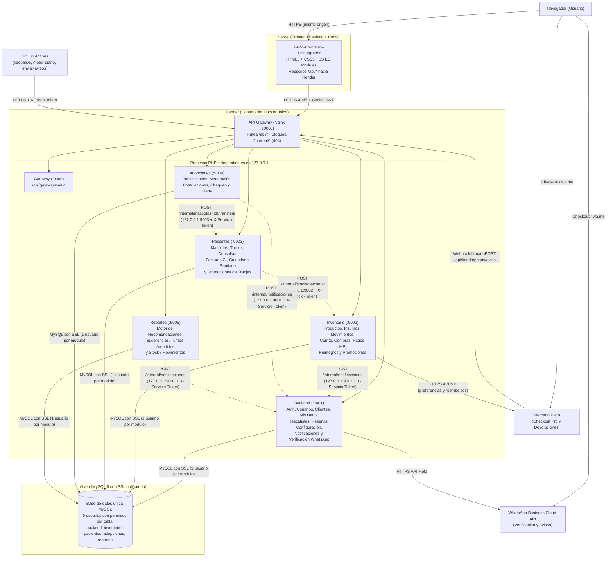

# Arquitectura del Sistema — HuellaVet (Entrega 5 Final)

Frontend en **Vercel**, API Gateway (**Nginx**) y cinco módulos PHP independientes (**Backend**, **Pacientes**, **Inventario**, **Adopciones** y **Reportes**) dentro de un único servicio Docker en **Render**, conectados por SSL a una única base **MySQL en Aiven**, y tareas programadas en **GitHub Actions**.

---

## 1. Diagrama de Arquitectura (Mermaid)

---

## 2. Dónde se despliega cada parte

| Parte | Plataforma | Por qué |
|---|---|---|
| **Frontend** | **Vercel** | Las páginas cargan rápido y están disponibles aunque el backend esté dormido. `vercel.json` reenvía `/api/*` a Render: el navegador ve todo bajo un único dominio (`huellavet-*.vercel.app`), por lo que la cookie `SameSite=Strict` funciona de forma nativa y no se habilita CORS. |
| **API Gateway + 5 módulos** | **Render** (Docker) | El plan gratuito ofrece 750 h/mes por cuenta (alcanza para un contenedor encendido todo el mes). Adentro corren Nginx y un proceso PHP separado por módulo (`127.0.0.1:9000` a `9005`), cada uno con sus propias variables de entorno filtradas con `env -u`. |
| **Base de datos** | **Aiven** (MySQL 8) | MySQL relacional con motor InnoDB (transacciones y claves foráneas), copias de seguridad automáticas y conexión TLS/SSL obligatoria con certificado CA. |
| **Tareas programadas** | **GitHub Actions** | Ejecuta `keepalive.yml` (cada 14 min), `motor-diario.yml` (una vez por día a las 09:00 ARG) y `enviar-avisos.yml` (cada 15 min para despachar WhatsApp y vencer/recordar compras de la tienda) autenticándose con `X-Tarea-Token`. |

---

## 3. Qué hace cada módulo y en qué puerto escucha

| Módulo | Proceso interno | Rutas públicas en Nginx | Usuario MySQL | Responsabilidad |
|---|---|---|---|---|
| **Gateway** | `127.0.0.1:9000` | `/api/gateway/*` | — | Comprobación de salud del contenedor (`GET /api/gateway/salud`). |
| **Backend** | `127.0.0.1:9001` | `/api/auth/*`, `/api/cuenta/*`, `/api/clientes/*`, `/api/rescatistas*`, `/api/notificaciones*`, `/api/configuracion*`, `/api/resenas*`, `/api/veterinaria/*`, `/api/backend/salud` | `backend` | Registro con verificación de WhatsApp, login con bloqueo por intentos, emisión del JWT (`RS256`), perfil ("Mis datos"), listado y ficha de clientes, validación de rescatistas, reseñas con respuesta de la veterinaria, parámetros configurables y cola de notificaciones (campana web y envío por WhatsApp). |
| **Inventario** | `127.0.0.1:9002` | `/api/inventario/*`, `/api/tienda/*` | `inventario` | ABM de productos e insumos, movimientos de stock, catálogo público, promociones de productos ("Publicitar"), carrito de compras, facturación `V-…`, cobro y webhook con Mercado Pago, devoluciones parciales configurables (75 % / 50 %) y tarea de vencimientos/recordatorios de retiro. |
| **Pacientes** | `127.0.0.1:9003` | `/api/pacientes/*` | `pacientes` | ABM de mascotas con foto, agenda de turnos (alta, reprogramación, cancelación, ausente), promociones de franjas horarias con descuento en la consulta, atención de consultas con descuento de stock en Inventario, emisión de facturas `C-…`, historial clínico y calendario sanitario. |
| **Adopciones** | `127.0.0.1:9004` | `/api/adopciones*` | `adopciones` | Publicación de animales por rescatistas aprobados, moderación de la veterinaria, postulaciones de clientes, elección del adoptante, asociación del turno de chequeo obligatorio y cierre con transferencia de la mascota al adoptante. |
| **Reportes** | `127.0.0.1:9005` | `/api/reportes/*` | `reportes` (solo `SELECT`) | Motor diario de recomendaciones (vacunas próximas, vacunas vencidas, controles de adopción a los 30 y 90 días, stock bajo y productos a liquidar), cruces de sugerencias ("Qué promocionar" y "Qué liquidar"), reporte de turnos atendidos y reporte de stock y movimientos. |

---

## 4. Cómo se comunican los módulos

1. **Navegador → Módulo (REST con JWT y CSRF)**:
   - El navegador pide `/api/...` a Vercel, Vercel lo reenvía a Render y Nginx lo deriva al proceso PHP dueño del prefijo.
   - Cada módulo verifica la firma del JWT por su cuenta usando `JWT_PUBLIC_KEY` (`comun/auth.php`), sin consultar a Backend.
2. **Lectura de datos de otro módulo (lectura directa en la base)**:
   - Un módulo puede hacer `SELECT` sobre las tablas de otro módulo para las lecturas previstas en la arquitectura (por ejemplo, Pacientes lee el precio de `producto` y el costo de `insumo`; todos leen `configuracion` mediante `comun/configuracion.php`; Reportes lee todas las tablas).
   - La regla *"cada módulo escribe solo en sus tablas"* la hace cumplir MySQL con los permisos de `base/permisos/`.
3. **Modificación de datos de otro módulo (llamada REST interna por `127.0.0.1`)**:
   - Nginx devuelve `404` a cualquier pedido externo hacia `/internal/*`.
   - Los módulos se llaman de proceso a proceso en `127.0.0.1:<puerto>` enviando `X-Servicio-Token: <INTERNAL_TOKEN>` y un `id_operacion` determinístico para que los reintentos sean idempotentes.

### Llamadas internas implementadas

| Origen → Destino | Endpoint interno | Cuándo se llama | Qué pasa si el destino no responde |
|---|---|---|---|
| **Pacientes → Inventario** | `POST http://127.0.0.1:9002/internal/stock/descontar` | Al finalizar una consulta con insumos o productos | Es parte obligatoria de la operación: la consulta queda `ABIERTA`, no se emite la factura y la veterinaria puede reintentar (el `id_operacion` evita descontar dos veces). |
| **Adopciones → Pacientes** | `POST http://127.0.0.1:9003/internal/mascotas/{id}/transferir` | Al completar una adopción con chequeo atendido | Es parte obligatoria: la adopción sigue en `CHEQUEO_PENDIENTE` y la veterinaria vuelve a tocar "Completar adopción". |
| **Adopciones → Backend** | `POST http://127.0.0.1:9001/internal/notificaciones` | Nueva postulación, postulación elegida, publicación aprobada/rechazada, chequeo programado y adopción finalizada/cancelada | Es un efecto secundario: la acción del circuito de adopción se guarda igual y el fallo queda registrado en el log. |
| **Inventario → Backend** | `POST http://127.0.0.1:9001/internal/notificaciones` | Pago aprobado (al comprador y a la veterinaria), recordatorios de retiro, cancelación por comprador o por vencimiento | Al pagar o cancelar en vivo, la compra sigue igual. En la tarea de vencimientos, si Backend no responde, la próxima corrida cada 15 minutos reintenta el aviso del día sin duplicarlo gracias al `id_operacion`. |
| **Reportes → Backend** | `POST http://127.0.0.1:9001/internal/notificaciones` | Tarea diaria del motor (`POST /api/reportes/tareas/diaria`): vacunas, controles de adopción, stock bajo y qué liquidar | Se contabiliza en `fallidos` y la siguiente ejecución vuelve a enviarlo sin duplicar los que ya se habían aplicado. |

---

## 5. Tareas programadas (GitHub Actions)

| Workflow | Frecuencia | Endpoints que invoca | Qué hace |
|---|---|---|---|
| `.github/workflows/keepalive.yml` | Cada 14 minutos | `GET /api/backend/salud`, `GET /api/inventario/salud` | Evita que Render y Aiven apaguen los servicios por inactividad. |
| `.github/workflows/motor-diario.yml` | Todos los días a las 09:00 ARG (`0 12 * * *` UTC) y manual (`workflow_dispatch`) | `POST /api/reportes/tareas/diaria` y `POST /api/notificaciones/tareas/enviar` | Evalúa las 5 reglas del motor de recomendaciones, encola los avisos en Backend y despacha de inmediato los WhatsApp pendientes. |
| `.github/workflows/enviar-avisos.yml` | Cada 15 minutos y manual (`workflow_dispatch`) | `POST /api/tienda/tareas/vencer` y `POST /api/notificaciones/tareas/enviar` | Cancela compras sin pagar vencidas, cancela compras no retiradas a tiempo, reintenta reintegros pendientes en Mercado Pago, encola recordatorios de retiro y envía los WhatsApp pendientes. |
