# Diagrama Entidad-Relación (DER) — HuellaVet (Entrega 5 Final)

Una única base de datos MySQL en Aiven compartida por los cinco módulos (**Backend**, **Inventario**, **Pacientes**, **Adopciones** y **Reportes**). Cada módulo se conecta con su propio usuario de MySQL, escribe únicamente en sus tablas y lee las de los demás módulos en modo solo lectura (`SELECT`).

El modelo completo de producción (migraciones `001` a `029`: todas las columnas con su tipo, claves, índices, `CHECK` y vistas) está también en DBML: [`modelo-produccion.dbml`](modelo-produccion.dbml). Se ve pegándolo en [dbdiagram.io](https://dbdiagram.io).

---

## 1. Diagrama Entidad-Relación (Mermaid)

```mermaid
erDiagram
    usuario ||--o{ verificacion_whatsapp : "verifica"
    usuario ||--o{ resena : "escribe (autor_id)"
    usuario ||--o{ resena : "responde (respondida_por)"
    usuario ||--o{ notificacion : "recibe"
    usuario ||--o{ configuracion : "actualiza"
    usuario ||--o{ movimiento_inventario : "registra"
    usuario ||--o{ carrito : "arma"
    usuario ||--o{ factura_compra : "entrega"
    usuario ||--o{ promocion : "publica"
    usuario ||--o{ mascota : "es duenio o tiene a cargo"
    usuario ||--o{ turno : "atiende"
    usuario ||--o{ promocion_franja : "publica"
    usuario ||--o{ publicacion : "publica (rescatista)"
    usuario ||--o{ adopcion : "adopta"
    usuario ||--o{ postulacion : "se postula"

    producto ||--o{ movimiento_inventario : "tiene"
    producto ||--o{ item_carrito : "contiene"
    producto ||--o{ item_producto_consulta : "vende"
    producto ||--o{ promocion : "promociona"
    producto ||--o{ lote_producto : "tiene lotes"
    lote_producto ||--o{ movimiento_inventario : "mueve"
    lote_producto ||--o{ promocion : "en promocion"

    insumo ||--o{ movimiento_inventario : "tiene"
    insumo ||--o{ item_insumo_consulta : "usa"
    insumo ||--o{ lote_insumo : "tiene lotes"
    lote_insumo ||--o{ movimiento_inventario : "mueve"

    carrito ||--o{ item_carrito : "contiene"
    carrito ||--o| factura_compra : "genera"
    factura_compra ||--o{ pago : "cobra"

    mascota ||--o{ turno : "agenda"
    mascota ||--o{ evento_sanitario : "calendario"
    mascota ||--o{ publicacion : "se publica"

    plan_sanitario ||--o{ evento_sanitario : "origina"
    promocion_franja ||--o{ turno : "aplica descuento"

    turno ||--o| consulta : "inicia"
    turno ||--|{ turno_motivo : "tiene"
    evento_sanitario ||--o{ turno_motivo : "se da en"
    turno ||--o| adopcion : "chequeo obligatorio"

    consulta ||--o{ item_insumo_consulta : "usa"
    consulta ||--o{ item_producto_consulta : "vende"
    consulta ||--|| factura_consulta : "genera"
    consulta ||--o{ evento_sanitario : "aplica"

    publicacion ||--o| adopcion : "abre"
    adopcion ||--o{ postulacion : "recibe"

    usuario {
        INT_UNSIGNED id PK
        VARCHAR_100 nombre
        VARCHAR_150 email UK
        VARCHAR_255 password_hash
        VARCHAR_30 telefono "NULL"
        ENUM rol "CLIENTE, VETERINARIO, RESCATISTA"
        VARCHAR_100 organizacion "NULL"
        ENUM estado_validacion "PENDIENTE, APROBADO, RECHAZADO (NULL)"
        TINYINT_UNSIGNED intentos_fallidos
        DATETIME primer_fallo_en "NULL"
        DATETIME bloqueado_hasta "NULL"
    }

    verificacion_whatsapp {
        INT_UNSIGNED id PK
        ENUM proposito "REGISTRO, CAMBIO"
        CHAR_10 telefono
        INT_UNSIGNED usuario_id FK "NULL"
        VARCHAR_255 codigo_hash
        TINYINT_UNSIGNED intentos
        DATETIME creado_en
        DATETIME vence_en
        DATETIME usado_en "NULL"
    }

    configuracion {
        VARCHAR_60 clave PK
        VARCHAR_255 valor
        DATETIME actualizado_en
        INT_UNSIGNED actualizado_por FK
    }

    resena {
        INT_UNSIGNED id PK
        INT_UNSIGNED autor_id FK
        TINYINT_UNSIGNED estrellas "1..5"
        VARCHAR_1000 texto
        DATETIME creada_en
        VARCHAR_1000 respuesta "NULL"
        DATETIME respondida_en "NULL"
        INT_UNSIGNED respondida_por FK "NULL"
    }

    notificacion {
        INT_UNSIGNED id PK
        INT_UNSIGNED usuario_id FK
        ENUM tipo "VACUNA, CONTROL_ADOPCION, STOCK_BAJO, PROMOCION, CUENTA, POSTULACION, COMPRA, RESENA"
        ENUM canal "WEB, WHATSAPP"
        VARCHAR_500 mensaje
        DATETIME fecha_programada
        DATETIME enviada_en "NULL"
        TINYINT_UNSIGNED intentos
        VARCHAR_100 ultimo_error "NULL"
        BOOLEAN leida
        VARCHAR_100 id_operacion UK
        DATETIME creada_en
    }

    producto {
        INT_UNSIGNED id PK
        VARCHAR_120 nombre
        TEXT descripcion "NULL"
        DECIMAL_10_2 precio
        INT_UNSIGNED stock
        ENUM categoria "MEDICAMENTO, ALIMENTO, ACCESORIO"
        ENUM especie_destino "PERRO, GATO, TODAS"
        ENUM etapa_vida "CACHORRO, ADULTO, SENIOR, TODAS"
        DECIMAL_6_2 peso_kg "NULL"
        DATE fecha_vencimiento "NULL (el lote con stock que vence primero, 028)"
        BOOLEAN vence "029"
        MEDIUMBLOB imagen "NULL"
        VARCHAR_20 imagen_tipo "NULL"
        BOOLEAN activo
    }

    lote_producto {
        INT_UNSIGNED id PK
        INT_UNSIGNED producto_id FK
        INT_UNSIGNED numero "L1, L2… (029)"
        VARCHAR_40 codigo "NULL (del fabricante)"
        DATE vencimiento "NULL"
        INT_UNSIGNED stock
        DATETIME creado_en
    }

    lote_insumo {
        INT_UNSIGNED id PK
        INT_UNSIGNED insumo_id FK
        INT_UNSIGNED numero "L1, L2…"
        VARCHAR_40 codigo "NULL (del fabricante)"
        DATE vencimiento "NULL"
        INT_UNSIGNED stock
        DATETIME creado_en
    }

    promocion {
        INT_UNSIGNED id PK
        INT_UNSIGNED producto_id FK
        INT_UNSIGNED lote_id FK "NULL"
        TINYINT_UNSIGNED porcentaje "5..90"
        DATE hasta
        DATETIME creada_en
        INT_UNSIGNED creada_por FK
        DATETIME terminada_en "NULL"
        TINYINT sin_terminar "GENERATED"
    }

    insumo {
        INT_UNSIGNED id PK
        VARCHAR_120 nombre
        ENUM aplicacion "SEXTUPLE, TRIPLE_FELINA, ANTIRRABICA, TOS_PERRERAS, LEUCEMIA_FELINA, ANTIPARASITARIO (NULL)"
        INT_UNSIGNED stock
        DATE fecha_vencimiento "NULL (el lote con stock que vence primero, 029)"
        BOOLEAN vence "029"
        DECIMAL_10_2 costo
        ENUM estado "DISPONIBLE, EN_FALTA, YA_PEDIDO"
        BOOLEAN activo
    }

    movimiento_inventario {
        INT_UNSIGNED id PK
        INT_UNSIGNED producto_id FK "NULL"
        INT_UNSIGNED lote_id FK "NULL"
        INT_UNSIGNED insumo_id FK "NULL"
        INT_UNSIGNED lote_insumo_id FK "NULL (029)"
        ENUM tipo "ENTRADA, SALIDA, AJUSTE"
        INT_UNSIGNED cantidad
        ENUM motivo "CARGA_VETERINARIO, CONSULTA, VENTA, AJUSTE, VENTA_CANCELADA"
        INT_UNSIGNED usuario_id FK "NULL"
        CHAR_36 id_operacion UK "NULL"
        DATETIME fecha
    }

    carrito {
        INT_UNSIGNED id PK
        INT_UNSIGNED cliente_id FK
        ENUM estado "ABIERTO, CONFIRMADO, PAGADO, RETIRADO, CANCELADO"
        DATETIME creado_en
        TINYINT abierto "GENERATED"
    }

    item_carrito {
        INT_UNSIGNED id PK
        INT_UNSIGNED carrito_id FK
        INT_UNSIGNED producto_id FK
        INT_UNSIGNED cantidad
        DECIMAL_10_2 precio_unitario
        INT_UNSIGNED cantidad_promocion
        DECIMAL_10_2 precio_promocion "NULL"
    }

    factura_compra {
        INT_UNSIGNED id PK
        VARCHAR_20 numero UK "V-000101"
        INT_UNSIGNED carrito_id FK "UK"
        DECIMAL_10_2 total
        ENUM estado "PENDIENTE_PAGO, PAGADA, ENTREGADA, CANCELADA"
        ENUM motivo_cancelacion "COMPRADOR, SIN_PAGO, VENCIDA (NULL)"
        DATETIME cancelada_en "NULL"
        TINYINT_UNSIGNED reintegro_porcentaje "NULL"
        DECIMAL_10_2 reintegro_monto "NULL"
        ENUM reintegro_estado "PENDIENTE, HECHO (NULL)"
        DATETIME reintegro_en "NULL"
        DATETIME fecha
        DATETIME pagar_antes_de "NULL"
        DATE retirar_hasta "NULL"
        TINYINT_UNSIGNED reintegro_anticipado "NULL"
        TINYINT_UNSIGNED reintegro_ultimo_momento "NULL"
        SMALLINT_UNSIGNED reintegro_horas "NULL"
        DATETIME entregada_en "NULL"
        INT_UNSIGNED entregada_por FK "NULL"
    }

    pago {
        INT_UNSIGNED id PK
        INT_UNSIGNED factura_compra_id FK
        DECIMAL_10_2 monto
        VARCHAR_64 id_externo UK "NULL"
        ENUM estado "PENDIENTE, APROBADO, RECHAZADO, DEVUELTO"
        DATETIME fecha
    }

    mascota {
        INT_UNSIGNED id PK
        INT_UNSIGNED duenio_id FK
        VARCHAR_80 nombre
        ENUM especie "PERRO, GATO, OTRO"
        VARCHAR_80 raza "NULL"
        DATE fecha_nacimiento "NULL"
        DECIMAL_5_2 peso_kg "NULL"
        MEDIUMBLOB foto "NULL"
        VARCHAR_20 foto_tipo "NULL"
        BOOLEAN activo
    }

    plan_sanitario {
        INT_UNSIGNED id PK
        ENUM especie "PERRO, GATO, OTRO"
        ENUM tipo "VACUNA, DESPARASITACION"
        VARCHAR_100 nombre
        ENUM aplicacion "SEXTUPLE, TRIPLE_FELINA, ANTIRRABICA, TOS_PERRERAS, LEUCEMIA_FELINA, ANTIPARASITARIO"
        SMALLINT_UNSIGNED orden "dosis: 1, 2, 3, refuerzo"
        SMALLINT_UNSIGNED edad_inicio_semanas
        SMALLINT_UNSIGNED repetir_cada_meses "NULL"
        BOOLEAN automatico "0: opcional, la agrega el veterinario"
    }

    evento_sanitario {
        INT_UNSIGNED id PK
        INT_UNSIGNED mascota_id FK
        INT_UNSIGNED plan_sanitario_id FK "NULL"
        ENUM tipo "VACUNA, DESPARASITACION"
        VARCHAR_100 nombre
        DATE fecha_programada
        DATE fecha_aplicada "NULL"
        INT_UNSIGNED consulta_id FK "NULL"
    }

    promocion_franja {
        INT_UNSIGNED id PK
        TINYINT_UNSIGNED dia_semana "1..6"
        ENUM franja "MANIANA, TARDE"
        TINYINT_UNSIGNED porcentaje "5..90"
        DATE hasta
        DATETIME creada_en
        INT_UNSIGNED creada_por FK
        DATETIME terminada_en "NULL"
        TINYINT sin_terminar "GENERATED"
    }

    turno {
        INT_UNSIGNED id PK
        INT_UNSIGNED mascota_id FK
        INT_UNSIGNED veterinario_id FK
        DATE fecha
        TIME hora
        ENUM motivo "principal: CONSULTA, VACUNACION, CHEQUEO_ADOPCION, DESPARASITACION, CASTRACION, CIRUGIA, CONTROL, URGENCIA"
        ENUM estado "PROGRAMADO, EN_ATENCION, ATENDIDO, CANCELADO, AUSENTE"
        DECIMAL_10_2 precio_consulta "NULL"
        TINYINT_UNSIGNED descuento "NULL"
        INT_UNSIGNED promocion_franja_id FK "NULL"
        TINYINT ocupa_horario "GENERATED"
    }

    turno_motivo {
        INT_UNSIGNED id PK
        INT_UNSIGNED turno_id FK
        ENUM motivo "CONSULTA, VACUNACION, CHEQUEO_ADOPCION, DESPARASITACION, CASTRACION, CIRUGIA, CONTROL, URGENCIA"
        INT_UNSIGNED evento_sanitario_id FK "NULL"
    }

    consulta {
        INT_UNSIGNED id PK
        INT_UNSIGNED turno_id FK "UK"
        TEXT diagnostico "NULL"
        TEXT observaciones "NULL"
        DECIMAL_10_2 valor_base
        ENUM estado "ABIERTA, FINALIZADA"
        DATETIME finalizada_en "NULL"
    }

    item_insumo_consulta {
        INT_UNSIGNED id PK
        INT_UNSIGNED consulta_id FK
        INT_UNSIGNED insumo_id FK
        INT_UNSIGNED cantidad
        DECIMAL_10_2 costo_unitario
    }

    item_producto_consulta {
        INT_UNSIGNED id PK
        INT_UNSIGNED consulta_id FK
        INT_UNSIGNED producto_id FK
        INT_UNSIGNED cantidad
        DECIMAL_10_2 precio_unitario
    }

    factura_consulta {
        INT_UNSIGNED id PK
        VARCHAR_20 numero UK "C-000101"
        INT_UNSIGNED consulta_id FK "UK"
        DECIMAL_10_2 subtotal_base
        DECIMAL_10_2 subtotal_insumos
        DECIMAL_10_2 subtotal_productos
        DECIMAL_10_2 total
        ENUM estado "PENDIENTE_PAGO, PAGADA"
        DATETIME fecha
    }

    publicacion {
        INT_UNSIGNED id PK
        INT_UNSIGNED rescatista_id FK
        INT_UNSIGNED mascota_id FK
        VARCHAR_120 titulo
        TEXT descripcion
        MEDIUMBLOB foto
        VARCHAR_20 foto_tipo
        ENUM estado_moderacion "PENDIENTE, APROBADA, RECHAZADA"
        VARCHAR_255 motivo_rechazo "NULL"
        BOOLEAN activa
        DATETIME creada_en
        TINYINT vigente "GENERATED"
    }

    adopcion {
        INT_UNSIGNED id PK
        INT_UNSIGNED publicacion_id FK "UK"
        ENUM estado "PUBLICADA, CON_POSTULANTES, ADOPTANTE_ELEGIDO, CHEQUEO_PENDIENTE, FINALIZADA, CANCELADA"
        INT_UNSIGNED adoptante_id FK "NULL"
        INT_UNSIGNED turno_chequeo_id FK "UK NULL"
        DATETIME fecha_inicio
        DATETIME fecha_fin "NULL"
    }

    postulacion {
        INT_UNSIGNED id PK
        INT_UNSIGNED adopcion_id FK
        INT_UNSIGNED cliente_id FK
        VARCHAR_60 tipo_vivienda
        VARCHAR_255 otras_mascotas
        VARCHAR_120 tiempo_disponible
        ENUM estado "PENDIENTE, ELEGIDA, RECHAZADA"
        DATETIME fecha
    }
```

---

## 2. Tablas y vistas por módulo y migración

| Módulo | Tabla / Vista | Migración | Entrega | Para qué sirve |
|---|---|---|---|---|
| **Backend** | `usuario` | `001` | E3 | Cuentas de clientes, veterinarios y rescatistas: credenciales, rol, validación de rescatista y bloqueo por intentos fallidos |
| **Backend** | `notificacion` | `008`, `011`, `018`, `019` | E5 | Avisos por la campana (`WEB`) o por `WHATSAPP`, con control de `id_operacion` único e historial de intentos/errores de envío |
| **Backend** | `configuracion` | `014` | E5 | Parámetros de la veterinaria editables desde el panel (horarios, precio de consulta, plazos y reintegros de tienda, umbrales del motor y datos de contacto) |
| **Backend** | `resena` | `019` | E5 | Reseñas públicas de clientes y rescatistas (1 a 5 estrellas, texto y respuesta opcional de la veterinaria) |
| **Backend** | `verificacion_whatsapp` | `019` | E5 | Códigos de 6 dígitos hasheados con vencimiento de 10 minutos para verificar el teléfono por WhatsApp al registrarse o cambiarlo |
| **Inventario** | `producto` | `002`, `028`, `029` | E3–E5 | Catálogo de la tienda con su precio, categoría, especie e imagen (`MEDIUMBLOB`). Desde la `028`, `stock` es la suma de sus lotes y `fecha_vencimiento` la del lote con stock que vence primero (los mantiene Inventario). Desde la `029`, si vence (`vence`): si vence, cada lote lleva su fecha; si no, ninguno |
| **Inventario** | `lote_producto` | `028`, `029` | E5 | Los lotes de cada producto, con su número L1, L2… (`numero`, `029`), el número del fabricante (opcional), su vencimiento (o ninguno) y su stock. Se vende y se usa en las consultas primero el lote sin vencer que vence antes |
| **Inventario** | `lote_insumo` | `029` | E5 | Los lotes de cada insumo, igual que `lote_producto`. Las consultas usan primero el lote sin vencer que vence antes |
| **Inventario** | `movimiento_inventario` | `002`, `003`, `010`, `028`, `029` | E3–E5 | Historial inmutable de variaciones de stock de productos e insumos (`ENTRADA`, `SALIDA`, `AJUSTE`) con `id_operacion` único. Desde la `028`, el lote de cada movimiento de producto (`lote_id`); desde la `029`, el de cada movimiento de insumo (`lote_insumo_id`) |
| **Inventario** | `insumo` | `003`, `025`, `029` | E3–E5 | Materiales internos de uso clínico (`DISPONIBLE`, `EN_FALTA`, `YA_PEDIDO`). Desde la `025`, qué vacuna o antiparasitario del calendario es (`aplicacion`). Desde la `029`, `stock` es la suma de sus lotes, `fecha_vencimiento` la del lote con stock que vence primero y `vence` si vence (como en `producto`) |
| **Inventario** | `carrito` | `010` | E5 | Carrito de compra de un cliente o rescatista (a lo sumo un carrito `ABIERTO` por usuario mediante columna generada `abierto`) |
| **Inventario** | `item_carrito` | `010`, `028` | E5 | Productos dentro del carrito con la cantidad y el precio cobrado al confirmar. Desde la `028`, cuántas unidades fueron con el descuento de la promoción y a qué precio (`cantidad_promocion`, `precio_promocion`) |
| **Inventario** | `factura_compra` | `010`, `012`, `015`, `017` | E5 | Factura `V-…` de la tienda con sus plazos (`pagar_antes_de`, `retirar_hasta`), motivo de cancelación y política/estado de reintegro parcial |
| **Inventario** | `pago` | `010`, `013` | E5 | Cobros de Mercado Pago (`PENDIENTE`, `APROBADO`, `RECHAZADO`, `DEVUELTO`) con `id_externo` único |
| **Inventario** | `promocion` | `016`, `028` | E5 | Descuentos del 5 % al 90 % sobre productos publicados desde las sugerencias de Reportes ("Qué liquidar"). Desde la `028`, de un lote (`lote_id`): el descuento vale para las unidades que le quedan a ese lote |
| **Pacientes** | `mascota` | `004` | E4 | Ficha clínica del animal con su foto y su dueño actual (cliente o rescatista) |
| **Pacientes** | `turno` | `004`, `020` | E4–E5 | Agenda de turnos con motivo, estado, horario liberado al cancelar (`ocupa_horario`) y precio/descuento congelado al reservar |
| **Pacientes** | `turno_motivo` | `026`, `027` | E5 | Los motivos de cada turno (puede tener varios); los de vacunación y desparasitación con el evento del calendario que se da. `turno.motivo` queda como el principal |
| **Pacientes** | `plan_sanitario` | `005`, `025` | E4 | Catálogo base de vacunas y desparasitaciones por especie y edad. La `025` suma qué vacuna es (`aplicacion`), la dosis (`orden`) y las opcionales (`automatico = 0`) |
| **Pacientes** | `evento_sanitario` | `005`, `006`, `025` | E4 | Calendario sanitario de cada mascota (programado y aplicado en consulta o a mano). Desde la `025` lo carga y edita el veterinario (no se arma solo), y cada vacunación o desparasitación de un turno queda atada a un evento (`turno_motivo`, `026`) |
| **Pacientes** | `consulta` | `006` | E4 | Atención clínica de un turno: diagnóstico, observaciones y valor base |
| **Pacientes** | `item_insumo_consulta` | `006` | E4 | Insumos utilizados en la consulta con su costo unitario histórico |
| **Pacientes** | `item_producto_consulta` | `006` | E4 | Productos agregados en la consulta con su precio unitario histórico |
| **Pacientes** | `factura_consulta` | `006` | E4 | Factura `C-…` emitida al finalizar la consulta (`subtotal_base + subtotal_insumos + subtotal_productos`) |
| **Pacientes** | `promocion_franja` | `020` | E5 | Descuentos del 5 % al 90 % sobre franjas de turnos (lunes a sábado, mañana o tarde) publicados desde "Qué promocionar" |
| **Adopciones** | `publicacion` | `007` | E5 | Aviso de adopción creado por un rescatista aprobado y moderado por la veterinaria (columna generada `vigente`) |
| **Adopciones** | `adopcion` | `007` | E5 | Proceso de adopción con 6 estados, adoptante elegido y turno de chequeo obligatorio |
| **Adopciones** | `postulacion` | `007` | E5 | Formulario de postulación del cliente interesado (`tipo_vivienda`, `otras_mascotas`, `tiempo_disponible`) |
| **Reportes** | `v_turnos_atendidos` | `009` | E5 | Vista de solo lectura que une turno atendido, consulta finalizada, conteo de insumos/productos y factura |

---

## 3. Decisiones de diseño en la base de datos

- **Políticas y precios guardados al momento de la operación**:
  - `factura_compra` guarda sus plazos (`pagar_antes_de`, `retirar_hasta`) y su política de reintegro (`reintegro_anticipado`, `reintegro_ultimo_momento`, `reintegro_horas`) al confirmarse el carrito. Si la veterinaria cambia la configuración en el panel, las compras ya confirmadas conservan lo que se le prometió al comprador.
  - `turno` guarda `precio_consulta`, `descuento` y `promocion_franja_id` al reservarse o reprogramarse: la consulta toma ese valor aunque la promoción termine antes del día del turno.
  - `item_carrito`, `item_insumo_consulta` e `item_producto_consulta` copian el precio o costo unitario del momento. `item_carrito` guarda además cuántas unidades se cobraron con el descuento de la promoción (`028`).
- **Stock por lote** (`028`): el stock de un producto está en `lote_producto`; `producto.stock` y `producto.fecha_vencimiento` son derivados (la suma y el primer vencimiento con stock) que Inventario actualiza en la misma transacción, así los módulos que solo leen `producto` siguen igual. Cada movimiento de un producto dice su lote: una venta cancelada devuelve cada unidad al lote del que salió. Desde la `029`, los insumos también tienen lotes (`lote_insumo`, con `insumo.stock` e `insumo.fecha_vencimiento` derivados), los lotes de cada producto o insumo se numeran 1, 2, 3… (L1, L2, L3… en la pantalla) y `vence` dice si sus lotes llevan fecha de vencimiento (lo controla Inventario; se cambia solo sin stock).
- **Columnas generadas para unicidad parcial en MySQL** (como MySQL no compara `NULL` en índices `UNIQUE`):
  - `turno.ocupa_horario`: `1` si no está cancelado, `NULL` si está `CANCELADO` → un turno cancelado libera la fecha y hora del veterinario.
  - `publicacion.vigente`: `1` si está activa y no rechazada, `NULL` en caso contrario → una mascota solo tiene una publicación abierta a la vez.
  - `carrito.abierto`: `1` si está `ABIERTO`, `NULL` si no → un comprador solo tiene un carrito abierto a la vez.
  - `promocion.sin_terminar` y `promocion_franja.sin_terminar`: `1` si `terminada_en IS NULL`, `NULL` si terminó → una sola promoción activa por producto o por franja, conservando el historial de promociones terminadas.
- **Idempotencia garantizada por índices únicos**:
  - `movimiento_inventario.id_operacion`, `notificacion.id_operacion` y `pago.id_externo` son `UNIQUE`: un reintento de red, un doble clic o dos corridas seguidas de una tarea programada nunca duplican movimientos, notificaciones ni pagos.

---

## 4. Permisos de MySQL por módulo (`base/permisos/`)

| Usuario MySQL | Escribe (`INSERT`, `UPDATE`, y `DELETE` solo donde se indica) | Solo lee (`SELECT`) |
|---|---|---|
| **`backend`** | `usuario`, `notificacion`, `verificacion_whatsapp`, `configuracion` (con `DELETE`), `resena` (con `DELETE`) | `mascota`, `adopcion` (para la ficha de clientes de la veterinaria) |
| **`inventario`** | `producto`, `lote_producto` (`028`), `insumo`, `lote_insumo` (`029`), `movimiento_inventario` (solo `SELECT, INSERT`), `carrito`, `item_carrito` (con `DELETE`), `factura_compra`, `pago`, `promocion` | `usuario`, `configuracion` |
| **`pacientes`** | `mascota`, `turno`, `turno_motivo`, `evento_sanitario` (con `DELETE`, `025`), `consulta`, `item_insumo_consulta` (con `DELETE`), `item_producto_consulta` (con `DELETE`), `factura_consulta`, `promocion_franja` | `plan_sanitario`, `usuario`, `producto`, `insumo`, `configuracion` |
| **`adopciones`** | `publicacion`, `adopcion`, `postulacion` | `usuario`, `mascota`, `turno`, `consulta` |
| **`reportes`** | — *(no tiene permisos de escritura en ninguna tabla)* | `usuario`, `mascota`, `turno`, `consulta`, `item_insumo_consulta`, `item_producto_consulta`, `factura_consulta`, `evento_sanitario`, `plan_sanitario`, `producto`, `lote_producto` (`028`), `insumo`, `lote_insumo` (`029`), `movimiento_inventario`, `adopcion`, `publicacion`, `configuracion`, `promocion_franja`, `turno_motivo`, `v_turnos_atendidos` |
